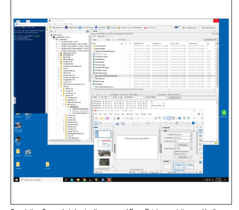
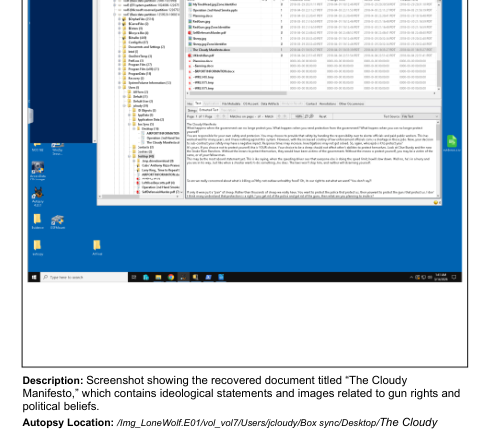
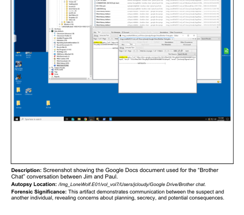

# Selected Workplace Drama Exhibit Previews

These previews are cropped from the **student's submitted Part C PDF**. They are not original forensic images and do not replace the complete evidence record. They illustrate Autopsy views and the existence of the reported exhibits, not independent verification of their contents.

## Exhibit A

**Reported artifact:** `Operation 2nd Hand Smoke.pptx` — presentation examined in the training case.

## Exhibit B

**Reported artifact:** `The Cloudy Manifesto.docx` — document examined in the training case.

## Exhibit C

**Reported artifact:** Brother Chat (Google Docs) — communication artifact examined in the training case.

**Privacy note:** These are low-resolution previews intended to show the investigation interface, not expose document text or investigative details. Do not publish the raw forensic image or full recovered documents.
